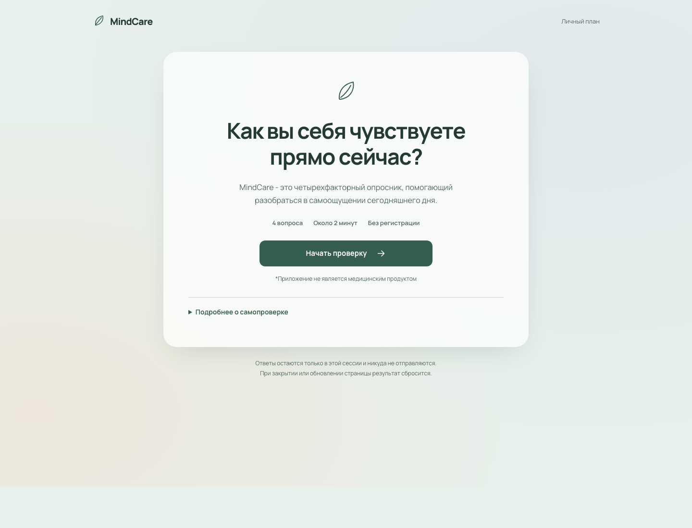

# MindCare

Короткая русскоязычная самопроверка: четыре вопроса о состоянии и четыре рекомендации на сегодня. Приложение открывается без регистрации; ответы остаются в памяти вкладки и сбрасываются при перезапуске.

**Демо:** [mindcare.adavid.ru](https://mindcare.adavid.ru)



## Возможности

- случайный активный вопрос из каждой из четырёх категорий: 95 вопросов и 81 рекомендация;
- выбор ответа, переход назад и проверка целостности связей между вариантами и рекомендациями;
- экран результата с рекомендациями, копирование результата и новая сессия;
- установка как PWA и локальное кеширование приложения после первого открытия;
- клавиатурная навигация, управление фокусом и адаптивная вёрстка.

## Стек и решения

Vue 3, TypeScript, Vite, Zod, vite-plugin-pwa, Yarn 1. JSON-контент проверяется схемой и явными ссылками на группы рекомендаций; сценарий опроса вынесен в отдельный модуль TypeScript. Ответы не отправляются в сеть и не сохраняются между сессиями. Шрифт Manrope поставляется локально по лицензии SIL Open Font License.

## Вклад

Frontend-разработка Давида Арамова: интерфейс и пользовательский поток на Vue, отдельный движок опроса на TypeScript, валидация JSON-контента и связей между ответами и рекомендациями, доступные формы, адаптивный интерфейс и PWA-установка. В репозитории также есть тесты логики опроса и валидации.

## Запуск и проверки

Требуются Node 24 и Yarn 1.22.22. Секреты и `.env` не нужны.

```sh
corepack enable
yarn install --frozen-lockfile
yarn dev
```

Откройте адрес Vite из терминала. Production preview запускается командой `yarn preview`. Проверки: `yarn test`, `yarn build`.

Проверено 29 октября 2026 года: 8 тестов прошли; `yarn build` завершился с проверкой контента, типов, production-сборкой и credential scan. PWA precache включает app shell, шрифты, изображения ответов и иконки. Локальный `yarn audit` сообщил о 14 high, 14 moderate и 11 low advisories по графу зависимостей (0 critical); релевантность отдельных записей для production-потока отдельно не оценивалась, версии зависимостей в этой подготовке не менялись. Главный экран в README снят с локального приложения. Установленное PWA и физический телефон отдельно не проверялись.

## Ограничения и права

Это не медицинская диагностика или терапевтический совет. Независимая клиническая проверка материалов не проводилась. Права владельца проекта на изображения и брендовые материалы подтверждены; отдельная открытая лицензия на них не заявляется. Подробности приведены в [ASSETS.md](ASSETS.md).
